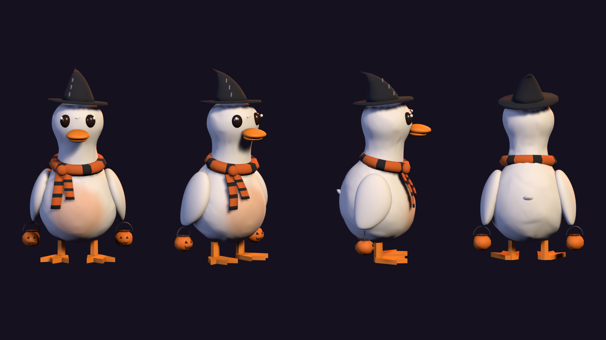
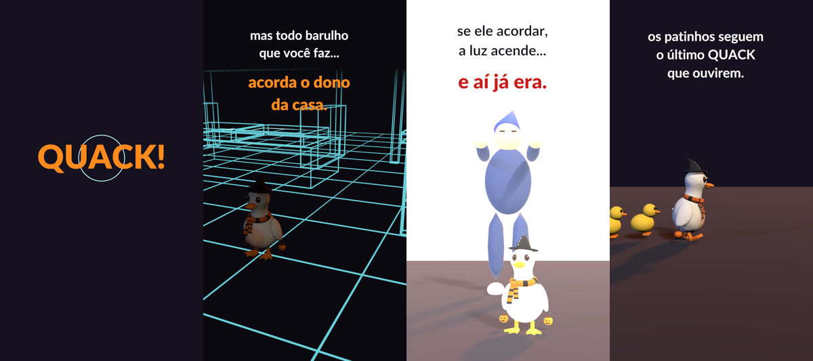
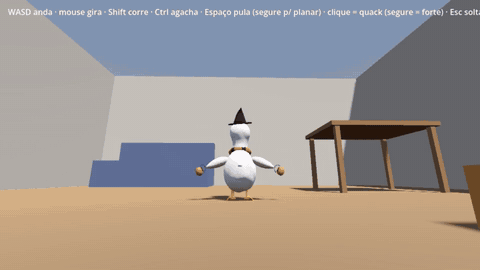

<div align="center">

# QUACKROOM

**Terror cooperativo onde você só enxerga quando grasna.**
**Mas todo barulho acorda o dono da casa.**

*Faça barulho. Se tiver coragem.*




</div>

---

## A história

Uma ninhada de patinhos se perdeu dentro de uma casa.

Os patos adultos entram pela portinha do cachorro para buscá-los — mas a casa está **no escuro
total**, e para um pato cada cômodo é **gigante**: o sofá é um prédio, a mesa é um telhado,
embaixo da cama é uma caverna.

E tem mais alguém andando no escuro. **O dono da casa é sonâmbulo.** Ele anda de olhos fechados,
guiado pelo som. Se ele acordar, acende a luz.

E aí… já era.



## O diferencial: o quack é o seu sonar

Em quase todo jogo de terror com som a regra é **fique quieto**. No Quackroom é o contrário:
**você só enxerga quando faz barulho.**

- Cada **quack** solta uma onda que acende os contornos da casa por alguns segundos.
- Todo mundo por perto vê — o quack de um amigo ilumina o caminho para você também.
- Mas **todo som enche a barra de sono do dono**. Alguém do grupo precisa grasnar…
  **e virar a isca.**

> **A regra de ouro:** todo som revela, e todo som acorda.

## Como se joga

| | |
|---|---|
| **Objetivo** | Encontrar os patinhos e levar a fila deles de volta ao ninho |
| **Patinhos** | Seguem o **último quack que ouviram** — em fila, atrás de quem grasnou |
| **Quack curto** | Sonar pequeno, pouco barulho |
| **Quack forte** | Sonar enorme, muito barulho |
| **Pisos** | Azulejo ecoa (o som vai longe) · carpete abafa (vai curto) |
| **O sonâmbulo** | Vai atrás de qualquer som. Se esbarrar em você, te prende numa caixa de papelão — seus amigos podem te soltar |
| **Barra de sono** | *profundo → inquieto → quase acordado → ACORDOU* (luz acesa = derrota) |
| **Vitória** | Pelo menos metade dos patinhos salvos. Estrelas por patinhos, tempo e quão perto o dono chegou de acordar |

**Controles:** WASD anda · mouse gira a câmera · Shift corre · Ctrl agacha ·
Espaço pula (segure para planar) · clique = quack (segure para quack forte)

## O pato

Em terceira pessoa, com animações de andar nas 4 direções (com gingado de pato), correr, pular
e planar batendo as asas, agachar e grasnar. Modelo, esqueleto e animações são **gerados por
script** no Blender (`arte/pato/`).



## Status

- [x] Conceito, design e direção de arte — [documento de design](docs/design/quackroom-design.md)
- [x] Pato: modelo, esqueleto e 8 animações
- [x] **Etapa 1 — Base:** projeto Godot, testes automáticos, pato importado
- [ ] **Etapa 2 — Pato + online básico** *(pato em 3ª pessoa pronto · rede em andamento)*
- [ ] Etapa 3 — Sonar (escuridão, shader, quack curto/forte, pisos)
- [ ] Etapa 4 — O sonâmbulo (rotina, audição, barra de sono, caixa)
- [ ] Etapa 5 — Patinhos, vitória e derrota
- [ ] Etapa 6 — A casa: sala, cozinha, banheiro e quarto
- [ ] Etapa 7 — Demo jogável no itch.io

## Procuro gente!

Este é meu primeiro jogo e quero levá-lo até o lançamento. Procuro pessoas para somar em:

- **Arte 3D e modelagem** — móveis gigantes, o sonâmbulo, os patinhos
- **Som e música** — o som é *a* mecânica do jogo
- **Programação (Godot / GDScript)** — rede, IA do sonâmbulo, shaders
- **Level design** — os cômodos e as rotas de fuga

**Quer entrar?** Abra uma [issue](../../issues) com o título **"Quero ajudar"** contando o que você
curte fazer — ou comente **QUACK** no vídeo do TikTok.

## Rodando o projeto

Precisa do [Godot 4.7](https://godotengine.org/download).

```bash
# abrir no editor (ou abra jogo/project.godot pelo Godot) e aperte F5 para jogar
godot --path jogo --editor

# testes automáticos
godot --headless --path jogo --script res://testes/rodar_testes.gd
```

Para regenerar o pato (precisa do Blender 4.2+):

```bash
blender --background --factory-startup --python arte/pato/gerar_pato.py -- arte/pato
blender --background --factory-startup --python arte/pato/animar_pato.py -- arte/pato sem-previa
```

## Estrutura

```
├── jogo/                  projeto Godot (abra jogo/project.godot)
│   ├── personagens/pato/  o pato: cena, script, lógica testada, modelo .glb
│   ├── mundo/             cenas jogáveis (sala_teste = laboratório)
│   ├── testes/            testes automáticos + demo que grava o pato jogando
│   ├── autoload/ sonar/ casa/ ui/   (próximas etapas)
│   └── ferramentas/       scripts de configuração do projeto
├── arte/pato/             o pato no Blender, gerado por script
├── marketing/tiktok/      vídeo de divulgação, gerado por script
└── docs/                  documento de design, referências e mídia
```

## Feito com

[Godot](https://godotengine.org) · [Blender](https://www.blender.org) ·
Python + NumPy/SciPy (trilha e efeitos sintetizados) · ffmpeg

## Licença

© 2026 rian144hz — todos os direitos reservados. O código está aberto para leitura e para quem
colabora com o projeto; veja [LICENSE](LICENSE).
